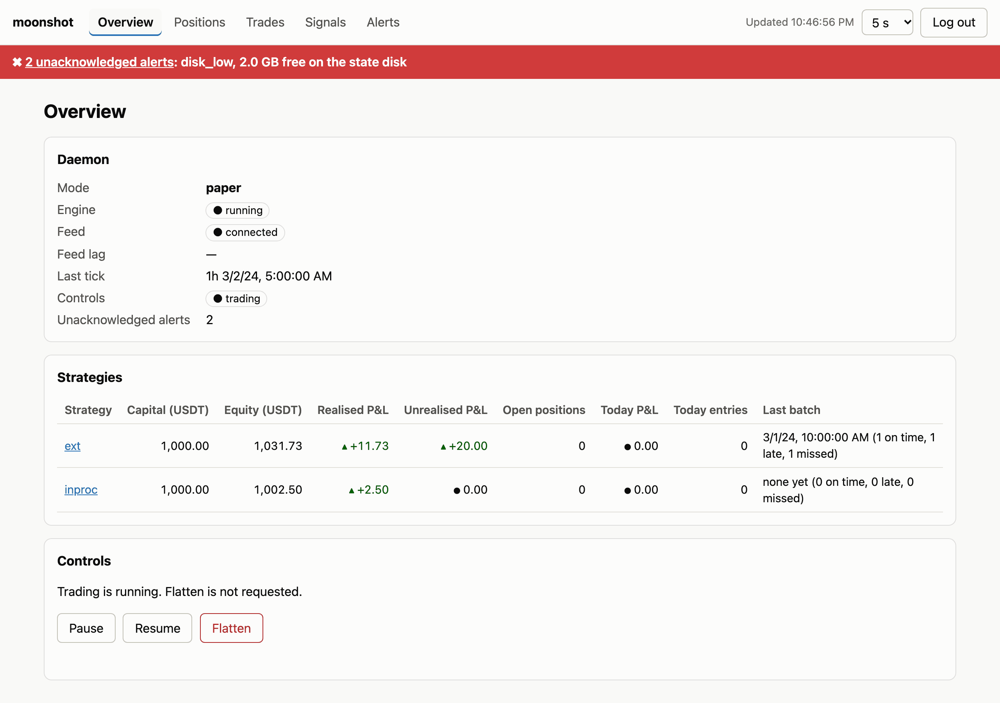
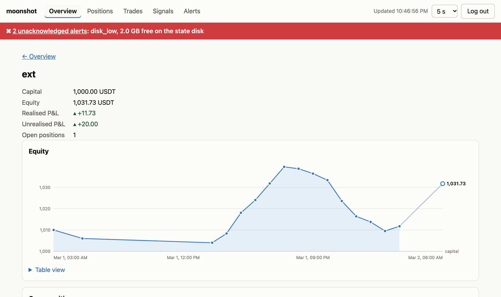

# crypto-moonshot

Personal toolkit for researching, backtesting and trading crypto on Binance.

Scope:

- **Research**: download historical data from Binance and analyse strategies.
- **Trading**: a daemon that runs strategies on live Binance candles, as paper trading or with
  orders on the Binance spot testnet (mainnet comes later).

## Setup

Requires [uv](https://docs.astral.sh/uv/).

```bash
uv sync
uv run pre-commit install
cp .env.example .env   # add Binance API keys when needed
uv run moonshot --help
```

## Downloading data

`moonshot data sync` downloads Binance spot candles into the local Parquet store (`./data`, or
`$MOONSHOT_DATA_DIR`, or `--data-dir`). It fetches only what is missing, in parallel across
symbols and months, so re-running it resumes an interrupted download. Public market data needs no
API keys. The stored format is described in [docs/data-format.md](docs/data-format.md).

```bash
uv run moonshot data sync BTCUSDT ETHUSDT                      # 5m candles since 2020-01-01
uv run moonshot data sync BTCUSDT SOLUSDT -i 1h -i 1d --start 2022-01-01 --concurrency 4
uv run moonshot data status                                    # what is stored, gaps, bad files
uv run moonshot data status BTCUSDT -i 1h --json
```

Intervals are case sensitive (`1m` is a minute, `1M` a month). Dates are `YYYY-MM-DD` or an ISO
datetime, in UTC unless an offset is given. Progress goes to stderr: live bars with a row per
download when stderr is a terminal, otherwise one plain line per event plus a snapshot every
5 seconds (`--progress bars|lines|none`, `-q` for none, `-v` for debug logs). The summary goes to
stdout.

For scripts and AI agents, ask for machine-readable output and plain progress:

```bash
uv run moonshot data sync BTCUSDT ETHUSDT -i 1h --json --progress lines 2>sync.log
```

stdout is then a single JSON object (`outcome`, `candles_added`, `requests`, and one entry per
symbol and interval with its `status`, `error` and stored range); `sync.log` has the progress.
Exit codes: 0 ok, 1 some downloads failed, 2 usage error, 3 aborted because Binance rate-limited
or banned the IP (the client stays under half of Binance's limit and stops after
`--max-rate-limit-hits` 429 responses), 130 interrupted. Months already written are kept.

To reuse data downloaded in another folder instead of fetching it again, import it:

```bash
uv run moonshot data import ../other-checkout/data --dry-run   # report only, writes nothing
uv run moonshot data import ../other-checkout/data
```

Each month file is checked against the current stored format (path, schema version, columns and
types, UTC, aligned, no duplicates, closed candles) and imported, merged into an existing month
(stored candles win) or skipped with its reasons; nothing is upgraded, so run `data sync` to
download whatever was skipped. The source is never modified. `--json` prints the report; the exit
code is 0 even when files were skipped.

## Backtesting

`moonshot backtest` runs a strategy over the stored candles and writes the results to
`results/<strategy>-<UTC timestamp>/` (gitignored): `trades.parquet` and `trades.csv`,
`equity.csv`, `yearly.csv` and `metrics.json` (metrics, skipped signals, the full configuration
and the data end used). It prints the overall metrics and a table per calendar year. Signals are
cached in `.cache/`, never in the data folder.

```bash
uv run moonshot backtest f2 --until 2026-11-02          # F2: pool, 5 equal slots, 1 hour hold
uv run moonshot backtest capitulation                   # R2: all coins, $50 stakes, +20% or 3 days
uv run moonshot backtest capitulation --fine --tp-fill close   # fill exits on 1m candles
uv run moonshot backtest f2 --slots 10 --hold 90m --stop 0.05 --fee 0.002 --out results/mine
uv run moonshot backtest convert-scores wf/base.npz seq2_meta.parquet scores/base.parquet
uv run moonshot backtest scores --scores scores/base.parquet --threshold 0.98 --json
```

`--slots N` compounds (stake = equity / N), `--stake USDT` keeps it fixed; `--hold` takes `1h`,
`90m`, `3d`, `2w`; `--take-profit`, `--stop` and `--trailing` are fractions (0 switches a preset's
level off); `--until` is the data end (later candles are ignored), `--start`/`--end` limit the
signal range; `--json` prints the `metrics.json` document on stdout. The presets and their
validation against the research results are in [docs/backtest-validation.md](docs/backtest-validation.md);
the design is in [docs/architecture.md](docs/architecture.md).

## Paper trading

The trading daemon follows live Binance candles (public market data, no API keys), runs your
strategies and keeps simulated positions in a SQLite state file. It places no orders anywhere:
in paper mode (`testnet` is described below; `live` is refused). The design is in
[docs/architecture.md](docs/architecture.md); writing a strategy is covered in
[docs/strategy-plugins.md](docs/strategy-plugins.md).

```bash
# 1. a secret for the API (the daemon refuses to start without one); keep it out of files and git
export MOONSHOT_API_TOKEN=<a-long-random-string>     # e.g. python -c 'import secrets; print(secrets.token_urlsafe(32))'

# 2. a run config: account, limits and strategies (see examples/paper.toml)
# 3. rehearse it over stored candles; prints the metrics like `moonshot backtest`
uv run moonshot live replay --config examples/paper.toml --start 2024-01-01 --end 2024-06-01 \
    --state /tmp/replay.sqlite

# 4. run it (the API listens on 127.0.0.1:8765 unless --host/--port say otherwise)
uv run moonshot live run --config examples/paper.toml

# 5. look at it and steer it, from another terminal
uv run moonshot live status                      # books, positions, providers, recent events
uv run moonshot live pause                       # no new entries (exits keep working)
uv run moonshot live resume
uv run moonshot live flatten                     # sell everything at the next candle (asks first)
uv run moonshot live status --config examples/paper.toml   # daemon down: reads the state file
```

Running it unattended: the daemon raises **alerts** (feed down, no ticks, a provider that keeps
missing batches, a failing plugin, the daily loss limit, failed backfills, stale symbols, a failed
backup, low disk; thresholds in the config's `[health]` table) that show up in `GET /api/v1/alerts`
and can be acknowledged with `POST /api/v1/alerts/{key}/ack`. It exits with code 3 when its
watchdog finds it stuck, so a restart policy (Docker's) brings it back from the state file, and only
one process can use a state file at a time. The state file is backed up automatically (at start and
daily, the newest 14 kept in `backups/` next to it); by hand:

```bash
uv run moonshot live backup --config examples/paper.toml              # safe while the daemon runs
uv run moonshot live restore state/backups/paper-20241101T000000Z.sqlite --config examples/paper.toml
                                                    # daemon stopped; the old file is kept beside it
uv run moonshot live run --config examples/paper.toml --log-format json   # JSON lines on stdout
```

A strategy that needs heavy libraries (a torch model, say) runs as an **external provider**:
list it in the config with `source = "external"` (`examples/paper.toml` has a commented
`cross_ext` entry) and run the same plugin file in its own environment, on this or another
machine:

```bash
uv run moonshot provider run examples/strategies/ma_cross.py:MaCross --name cross_ext \
    --url http://127.0.0.1:8765 --param fast=12 --param slow=48
```

To rehearse an external strategy, add `--serve` to `live replay`: the replay waits for the
provider, then they trade together over the same API. Exit codes of the `live` and `provider`
commands: 0 ok, 1 runtime failure, 2 usage or configuration error, 3 the daemon's watchdog stopped
it, 130 interrupted.

## Dashboard

The daemon (and `live replay --serve`) serves a web dashboard on the same port as the API. Open
`http://<host>:8765/` in a browser on the LAN and paste the API token (`MOONSHOT_API_TOKEN`) at the
login. The token stays in the tab's `sessionStorage` only, so closing the tab logs you out. The
pages show the overview and health, a chart per strategy, positions and orders, trades, signals
and providers, and the alerts (the only place they appear: acknowledge them here), and have
pause, resume and flatten buttons. There is no TLS, so keep it on a trusted network.




## Development

```bash
uv run ruff format .     # format
uv run ruff check .      # lint
uv run mypy src tests    # type check
uv run pytest            # test
uv run playwright install chromium   # once, for the dashboard's browser tests
uv run pytest -m browser --tracing off
```

Add dependencies with `uv add <pkg>` (or `uv add --dev <pkg>` for tooling) so `uv.lock` stays in sync.

Commits follow Conventional Commits. See [CONTRIBUTING.md](CONTRIBUTING.md).

## Safety

This repository is public. API keys go in `.env`, which is gitignored; keys and the daemon's
`MOONSHOT_API_TOKEN` are never logged. Use the Binance spot testnet until a strategy has been proven.

### Testnet (fake money)

Create keys at <https://testnet.binance.vision/>, put `MOONSHOT_BINANCE_TESTNET_API_KEY` and
`MOONSHOT_BINANCE_TESTNET_API_SECRET` in `/Users/mike/code/crypto-moonshot/.env` (`chmod 600`;
see `.env.example`), then, from any checkout or worktree:

```bash
uv run moonshot exchange check --env-file /Users/mike/code/crypto-moonshot/.env   # read-only
uv run moonshot live run --config examples/testnet.toml \
    --env-file /Users/mike/code/crypto-moonshot/.env
```

`--env-file` loads that file's variables for the one process (paper mode never reads an env file;
without the option testnet reads `./.env` if present). The daemon refuses any Binance host other
than the testnet. Step by step: [docs/runbook.md](docs/runbook.md#first-testnet-run).

## Running in Docker

The paper trading daemon and its dashboard run in a container (non-root, read-only filesystem,
restart policy, healthcheck). In short: copy `moonshot.env.example` to `moonshot.env` and set a
token, put a config (start from `deploy/config/paper.toml`) in `./config` and your plugins in
`./strategies`, `chown 10001:10001 state`, then `docker compose up -d --build` and open
`http://<host>:8765/`. The full operator's guide (Proxmox, alerts, backups, upgrades, security) is
[docs/runbook.md](docs/runbook.md).
