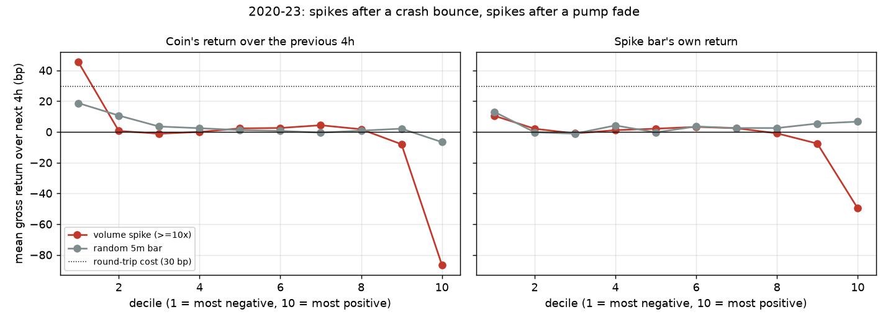
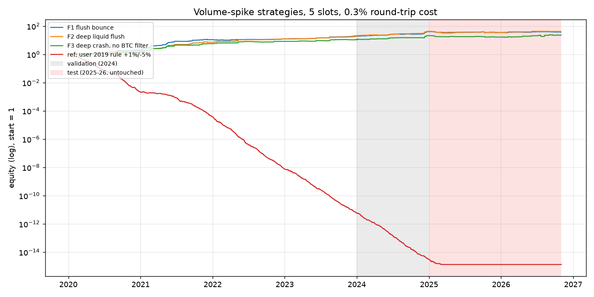
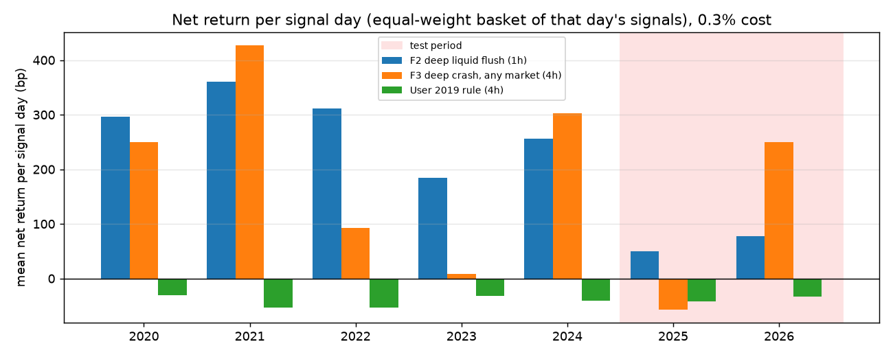

# Volume-spike strategy research

Overnight exploration, 2026-11-02, of the user's 2019 idea: *a sudden spike in 5-minute volume
precedes a price jump, so buying the spike and taking a small profit wins more often than it
loses.* Code and result tables are in `research/volume_spike/`; the run log is in
`docs/plans/volume-spike-research.md`.

## Summary

1. **The 2019 rule loses money, in every year, at every holding period.** Buying 5m volume
   spikes on up bars, mostly bought by takers, with no prior run-up, and exiting at +1% / −5%
   wins 52–67% of trades but loses about 0.3% per trade after a 0.3% round-trip cost (79k trades,
   2020–2026). A high win rate with a small target and a wide stop is exactly the trap: a few
   stops wipe out many small wins.
2. **A volume spike on its own predicts nothing.** Across 2M spikes, the price drift over the
   next 1–4 hours is within about ±5 bp of random bars, far below the 30 bp it costs to trade.
3. **What the spike *does* tell you depends on what happened before it.**
   - After a sharp **pump**, a spike marks exhaustion: −50 to −90 bp over the next 4 hours.
   - After a sharp **crash**, a spike marks capitulation: the price bounces. The deeper the crash,
     the bigger the bounce, and the bounce is much bigger than after a crash with no spike.
4. **The capitulation bounce is a real, large edge in 2020–2024, but only during market-wide
   flushes.** It works when BTC is also crashing (BTC volume spike, or BTC down 2%+ in 4h); a coin
   crashing alone (hack, unlock, delisting) does not bounce.
5. **It decayed badly in 2025.** The untouched 2025–2026 test period is roughly break-even for the
   moderate versions and only modestly positive for the most extreme ones. 2026 so far looks
   better than 2025, but there is too little data to call a recovery.
6. **Honest headline:** a walk-forward version (parameters re-chosen every six months from the
   previous two years only) made about +20% a year from 2022 to 2026 with a −16% worst drawdown,
   trading on about 40 crash days a year, and was flat in 2025. That is promising enough to
   paper-trade, not to fund.
7. **A convolutional network on the raw candles (added 2026-11-03) is the most promising lead.**
   A 1D CNN that sees the 8 hours of candles before each spike, for the coin and for BTC, picks
   which spikes to buy within a crash day better than any rule. In the 5-slot portfolio it made
   +114 bp per trade in 2025–26 (+33% a year, −11% worst drawdown, positive in both years) where
   F2 and the boosted trees were flat. That holds without 2025-10-10, at 1% costs and one candle
   late. Caveats: the portfolio view was a post-hoc check, the test is one 22-month period, and
   survivorship bias hits this kind of rule hardest.

8. **The walk-forward CNN study (27 variants, each tested on five out-of-sample years, 2022–26)
   confirms the ranking edge, but shows that picking configurations on past results fails.**
   Simple setups (the first CNN's design, a path forecaster, or an equal-weight ensemble of all
   variants) with a plain 1h hold made money in every test year. The ensemble made +192, +171,
   +137, +68 and +76 bp per trade, with a worst drawdown of −13%. The pre-registered "best" pick
   (a 4h-target CNN with a tuned rule) lost 9% in 2025 and 32% in 2026. The edge is shrinking:
   2025–26 is about +9% a year, about zero at a 1% round trip, and halved by a one-candle delay.

9. **Survivorship (M13): adding 430 delisted and smaller coins cut the edges but didn't erase the
   market-wide ones.** Rules that buy any deep crash break (F3: −148 bp per trade in 2025–26).
   F2, the deep, liquid, market-wide flush, still made money every year from 2020 to 2024 in every
   universe. The CNN ensemble on every USDT pair makes +105 bp per trade over 2022–26 (95% CI +41
   to +173; the placebo is −79 bp), but 2025 is only +20 bp, and it turns negative at 0.6% costs or
   one candle late.

The visual casebook (every method, with sketches, charts and the data behind them) is a private
claude.ai page: https://claude.ai/artifact/RpfQqzAyte82MWYGXm7Yn5. Rebuild it locally with
`uv run python research/volume_spike/report_data.py`, which writes `report/index.html`.



## Method

- **Data:** Binance spot 5m candles, 2020-01 to 2026-11, for the 198 USDT pairs downloaded with
  `moonshot data sync`. Stablecoins, fiat, gold, wrapped assets and tokenised stocks are dropped,
  leaving 152 coins. Each coin's first week is skipped.
- **Spike:** a closed 5m candle whose volume is at least 10× the median 5m volume of the previous
  24 hours (about the top 3% of candles; 4× turned out to be 10% of all candles).
- **No look-ahead:** every feature uses candles up to and including the spike candle. The trade
  enters at the **next candle's open**. Stops are checked before targets inside a candle.
- **Costs:** 0.1% fee + 0.05% slippage per side, 0.3% round trip; stressed at 0.6% and 1.0%.
- **Splits:** train 2020–2023, validation 2024, test 2025-01 to 2026-10. The finalists were
  written into the plan (commit `7d26050`) before the test period was looked at.
- **Portfolio simulation:** 5 equal slots, one position per coin, compounding; simultaneous
  signals are taken deepest-crash first. Because crash signals cluster on a few days, results are
  also reported **per crash day** (an equal-weight basket of that day's signals), which is less
  sensitive to which coins happen to grab the slots.

## Findings in detail

### The original rule and the raw spike (train 2020–2023)

| Entry                                   | Exit                | Trades  | Net per trade | Win rate |
| --------------------------------------- | ------------------- | ------- | ------------- | -------- |
| Every spike                             | +1% / −5% / 4h      | 775k    | −31 bp        | 60%      |
| Every spike                             | best of 125 exits   | 775k    | −22 bp        | 42%      |
| Random 5m bar                           | best of 125 exits   | 118k    | −24 bp        | 42%      |
| 2019 rule (up bar, taker buys > 60%)    | +1% / −5% / 4h      | 42k     | −30 bp        | 57%      |

Spikes on up bars, the core of the 2019 idea, drift *down* afterwards (−12 bp over 4h, gross).

### Capitulation

Gross 4h return after a spike, by the coin's prior 24h return (train): the bottom decile is
+47 bp versus +15 bp for random bars after the same drop; the top decile is −86 bp. Inside the
crash subset, bounces are bigger when the drop is fast (last 1–4h), the spike candle has a huge
range, the coin is at its 24h low, BTC is crashing too, and the coin is liquid. Extreme taker-buy
shares (either way) are worse than middling ones.

The big wins are real moves, not bad ticks: 2020-03-12, 2021-05-19, 2021-12-04, 2022-05/11,
2024-08-05 and similar flushes, where liquid coins fell 20–40% and bounced. Dropping the 20 busiest
crash days still leaves +2.4% per trade.

### Finalists (5 slots, 0.3% cost)

| Rule | Train 2020–23 | Valid 2024 | **Test 2025–26** |
| ---- | ------------- | ---------- | ---------------- |
| **F1** spike, coin −8% in 4h, ≥ 5k USDT/bar, BTC volume ≥ 6×, hold 1h | +148 bp/trade, 5.2/wk, CAGR 114%, DD −15% | +140 bp, CAGR 112%, DD −7% | **−3 bp, CAGR −5%, DD −21%** |
| **F2** spike, coin −10% in 4h, ≥ 20k USDT/bar, BTC volume ≥ 6×, hold 1h | +273 bp, 2.7/wk, CAGR 110%, DD −10% | +284 bp, CAGR 105%, DD −7% | **+15 bp, CAGR 0%, DD −22%** |
| **F3** spike, coin −15% in 4h, ≥ 5k USDT/bar, hold 4h | +366 bp, 1.6/wk, CAGR 81%, DD −11% | +566 bp, CAGR 103%, DD −6% | **+42 bp, CAGR +5%, DD −24%** |



Per crash day, which is the steadier measure, F2 made +185 to +360 bp in each year 2020–2024 with
79–91% of crash days positive; +50 bp (2025) and +78 bp (2026) with about 60% positive.



### Robustness checks (2020–2024)

- Positive in every calendar year 2020–2024, for all three finalists.
- Survives a 1.0% round-trip cost (F3 with a 4h hold: +405 bp → +335 bp per trade).
- Works on coins listed before 2020 and on newer ones (checked for F3 and a broader variant),
  so it is not only new-listing chaos.
- **Speed matters:** entering one candle (5 minutes) later loses about a third of the edge.
- Stops, targets and trailing stops did not beat a plain time exit; 1h holds were best.
- Limit orders below the spike close looked better the deeper they sat in 2020–2024 (+203 bp per
  fill at the close, +651 bp at 5% below, F1 in 2020–23), but reversed in 2025–26 (−36 down to
  −404 bp): the deep fills came from crashes that kept going (adverse selection).
- Majors only (BTC, ETH, SOL, BNB, XRP and 10 others) during flushes: +120 to +350 bp per trade
  each year 2020–2024 and 2026, negative in 2025.

### What happened in 2025

- Only the most extreme flushes kept working (coin −15% or more in 4h, or BTC −5% or more).
  Moderate dips kept dipping, especially in coins listed less than a year earlier.
- Market-regime filters (equal-weight alt index 7/30/90-day trend) and volatility-scaled crash
  depth did not fix it.
- Results inside 2025 swing from −0.5% to +3% per trade with small changes such as the number of
  slots: the year is decided by which handful of coins get bought on a few crash days.
- 2025-10-10 (the liquidation cascade with 80–99% wicks on some Binance alts) is not what drives
  the result either way; excluding it moves the test numbers by 5–20 bp per trade.

### Walk-forward (the number to believe)

Every six months, the rule with the best t-statistic over the previous 24 months (grid: drop 8–20%,
liquidity 5k–50k, BTC volume filter 0–10×, hold 1h or 4h) is traded for the next six months, as an
equal-weight basket per crash day with half of equity committed per day:

| Period            | Crash days | Net per crash day | Days positive |
| ----------------- | ---------- | ----------------- | ------------- |
| 2022              | 34         | +276 bp           | 79%           |
| 2023              | 27         | +107 bp           | 74%           |
| 2024              | 56         | +132 bp           | 77%           |
| 2025              | 74         | +15 bp            | 53%           |
| 2026 (to Oct)     | 23         | −99 bp            | 57%           |
| **2022–2026**     | **214**    | **+87 bp**        | **66%**       |

Equity ×2.44 over 4.8 years (CAGR about +20%), worst drawdown −16%.

### Convolutional network on the raw candles (M7)

Protocol fixed in the plan before training (commit `f06ce92` recorded the choices before the
test was opened): every spike, the last 96 candles (8h) as channels (OHLC as log ratio to the
spike close, volume relative to the day's median, taker-buy share; plus BTC close and volume in the
second variant) and the coin's liquidity, predicting the net 1h return. Fit on 2020–2023, an
average of 3 runs, epochs and variant chosen on 2024, test once on 2025–26. The network has 54k
weights (`m11_cnn.py`; sequences from `build_seq.py`).

- **Training:** both variants overfit after 1–3 epochs (2024 correlation 0.14–0.17), so each run
  keeps its best epoch. Coin + BTC beat coin-only on 2024 at every threshold and was chosen, at the
  top 0.5% of scores.
- **Pre-registered measure (every trade, one per coin):** 2025–26 −110 bp per trade but +177 bp per
  signal day (60% of 101 days positive); the boosted trees at the same threshold −161 bp and +56 bp.
  The losses pile up on a few days with dozens of simultaneous signals.
- **As an enter-or-skip filter on F1: failed** in the test (enter −155 bp, skip +36 bp per trade).
- **Post-hoc, 5-slot portfolio, highest score first:**

| 2025–26 test                | Trades | Net / trade | CAGR  | Max DD |
| --------------------------- | ------ | ----------- | ----- | ------ |
| CNN, coin + BTC             | 254    | +114 bp     | +33%  | −11%   |
| … without 2025-10-10        | 235    | +114 bp     | +32%  | −7%    |
| … 3 / 10 slots              |        | +127 / +87 bp |     |        |
| … 1% round-trip cost        | 254    | +44 bp      | +9%   | −15%   |
| … entering one candle late  | 254    | +79 bp      | +19%  | −14%   |
| CNN, coin only (rejected on 2024) | 466 | −21 bp | −13%  | −40%   |
| Boosted trees, top 0.5%     | 333    | +10 bp      | −1%   | −26%   |
| F2 rule                     | 178    | +15 bp      | 0%    | −22%   |

- **Not just crash depth:** its 2025–26 picks fell a median 29% in 4h with BTC volume spiking, but
  simple deep-flush rules in the same portfolio don't match it (−15%: +27 to +85 bp; −20%: losses;
  −25%: −9 to +139 bp on 10–22 trades once 2025-10-10 is left out; `results/m11_rule_compare.csv`).
  The edge is in ranking coins within a crash day, and the BTC channels are essential.

### Walk-forward CNN study (M9–M11)

The M7 result rested on one test period that had already been looked at, so the study was
rebuilt to test every idea on five out-of-sample years. For each test year Y in 2022–2026 a model
is trained on liquid spikes (≥ 5k USDT per candle, 632k in all) before Y−1 July, stopped early on
Y−1 July–December, and scores year Y. Scores become percentiles of that fold's own training
scores. The dataset (`build_seq2.py`) has 24h of candles and 13 channels: the coin's OHLC,
volume, taker share and trade count; BTC and ETH price and volume; the equal-weight market move;
and the share of coins spiking. Portfolio: 5 slots, top 2% of scores, 0.3% cost.

- **Screen (`m12_cnn_wf.py`, `results/m12_variants.csv`):** 20 variants, each changing one thing:
  window (2h / 8h / 24h), channels (coin only, +ETH, +market, all), scalars, target (30m / 1h /
  4h), loss (MSE, Huber, classification, rank within the day), architecture (CNN, wide CNN,
  dilated TCN, conv+GRU, MLP), training only on crash-context spikes, and an 8h path forecaster.
  The top four by the pre-registered 2022–24 rule and three combinations were re-run with 5 seeds.
- **Picking on the past doesn't work.** Across 27 variants the rank correlation between 2022–24
  and 2025–26 results is −0.06 (2024 alone: −0.43). The best-looking variants (4h targets,
  crash-only training, the combinations) failed in 2025–26; those with market-breadth channels
  held up best, but that wasn't used to choose.
- **Rule tuning overfits too (`m13_policy.py`).** About 200 rules (thresholds, slots, holds,
  targets, stops, a BTC-flush gate, score sizing, day caps, cool-downs) were tried per finalist.
  The rule that won on 2022–24 did worse in 2025–26 than the default (top 2%, 1h, 5 slots) for
  almost every variant.
- **Official pre-registered pick:** the 4h-target CNN, hold 4h, 3 slots. +72% a year on 2022–24,
  then −9% (2025) and −32% (2026), with a −39% drawdown.

| 5-slot portfolio, walk-forward | 2022 | 2023 | 2024 | 2025 | 2026 |
| ------------------------------ | ---- | ---- | ---- | ---- | ---- |
| Official pick (4h CNN, 4h hold, 3 slots) | +37% | +97% | +82% | −9% | −32% |
| Ensemble of all 19 variants, 1h, 5 slots | +58% | +39% | +49% | +9% | +7% |
| Base CNN (M7 design), 1h, 5 slots | +66% | +37% | +23% | +28% | +13% |
| Path forecaster (all channels), 1h, 5 slots | +56% | +39% | +21% | +20% | +19% |

- **The ensemble** (post-hoc in motivation, but with nothing tuned: members = every screened
  variant, threshold only matched to the base model's 2022–24 trade count; `m12_cnn_wf.py ens`)
  makes +138 bp per trade over 2022–26 (bootstrap 95% CI +64 to +221). It's positive in every
  year at 0.6% costs, about zero in 2025–26 at 1%, and still positive every year without its
  5 best days. Entering one candle late drops it to +64 bp. 93% of 30 random 10-variant
  sub-ensembles are positive in 2025–26 (`m14_robust.py`, `results/m14_robust_ens_all.csv`).
- **Placebo:** shuffling the scores within each day (same days, same counts) gives −77 bp per
  trade against +138 bp. The ranking within a crash day is the edge.

### The CNN as a forecasting engine

The user's idea: forecast the price path for the next hours and let the forecast set the trade.
The path variant predicts the net return every 15 minutes out to 8 hours, at the 10%, 50% and
90% quantiles (pinball loss). `m15_forecast.py` checks it:

- **Calibration:** the 10–90% band holds 73–78% of real outcomes (80% intended, so slightly too
  narrow), and the average forecast matches the average outcome.
- **Ranking:** correlation with the real return is 0.30 at 15m, 0.23 at 4h and 0.21 at 8h.
- **Shape right, size optimistic:** the top decile forecasts a +2.1% peak; it really averages
  +0.4% after 1h and +0.7% after 4h.
- **Forecast-driven rules** (rank by forecast peak, exit at the forecast peak time, take profit
  at the p90 peak, stop at the p10 trough): exiting at the peak alone is worse than a 1h hold.
  Adding the target and stop made +211% in 2025 on 826 trades, but about −2% in 2026, and it
  failed the 2022–24 drawdown limit. Requiring a +2% forecast upside was positive every year
  but faded to +1% in 2026. The forecast works best as a ranking.

### Survivorship: delisted and fallen coins (M13)

The data pool was today's top ~200 USDT pairs. Binance's public archive (data.binance.vision)
still has the rest: 191 delisted pairs (status BREAK, e.g. MATIC, WAVES, SRM, ANC, MIR) and 239
still listed outside the pool (incl. LUNA with its May 2022 crash, FTT, USTC). Tokenised stocks
and stablecoins are left out as before. `fetch_archive.py` downloaded 18,846 checksum-verified
months and imported them with `moonshot data import` into the main data folder; the lists are
`delisted.txt` and `outside_pool.txt` there (`docs/data-format.md`). A position open at a
delisting or halt exits at the last traded price. Nothing was re-tuned. Runs:
`run_universe.sh poolA|all`, results in `results/universe_*/` and `results/m16_survivorship.csv`.

| Net bp per trade, 5 slots | Universe | 2022 | 2023 | 2024 | 2025 | 2026 |
| -------------------------- | -------- | ---- | ---- | ---- | ---- | ---- |
| F2 rule | pool / +delisted / all | +223 / +75 / +188 | +287 / +209 / +195 | +284 / +242 / +161 | −44 / −37 / −7 | +187 / +313 / +219 |
| F3 rule (no BTC filter) | pool / +delisted / all | +284 / +258 / +187 | +252 / +126 / +37 | +569 / +20 / +26 | −158 / −243 / −196 | +207 / +40 / −80 |
| Base CNN, 1h | pool / +delisted / all | +334 / +191 / +93 | +170 / +129 / +175 | +57 / +62 / +74 | +67 / +23 / +5 | +53 / +252 / +21 |
| Market CNN, 1h | pool / +delisted / all | +257 / +232 / +96 | +184 / +303 / +181 | +89 / +60 / +23 | +88 / +53 / −16 | +175 / +44 / +122 |
| Path forecaster, 1h | pool / +delisted / all | +278 / +135 / +158 | +206 / +316 / +215 | +107 / +89 / +73 | +65 / +104 / +63 | +101 / −104 / +212 |
| CNN ensemble, 1h | pool / all | +192 / +116 | +171 / +207 | +137 / +88 | +68 / +20 | +76 / +213 |

- **The BTC filter matters most.** Coins crashing while the market is calm are often dying.
  F3's worst real trade bought LUNA on 2022-05-12 and lost 99.8% in its 4-hour hold; F2's best
  bought it the day before and made +218% in an hour.
- **Rule walk-forward (m7), OOS 2022–26:** pool +20% a year (DD −16%); +delisted +6% (DD −35%);
  all +20% (DD −24%). The re-tuned rule is sensitive to which coins it sees.
- **On the full universe, 50–87% of CNN trades in 2022–25 are in coins outside today's top
  200.** The ensemble still makes +105 bp per trade (CI +41 to +173, placebo −79) and the path
  forecaster +119 bp (CI +46 to +192). 2025 is the weak year for every strategy.
- Not covered: UST before its rename (excluded as a stablecoin), and coins delisted before 2020.

### Other ideas tried (none beat the capitulation rules)

| Idea | Result |
| ---- | ------ |
| Breakout: spike on an up bar at a new 7-day high | Negative at 1h and 4h; +20 to +90 bp at 24h, which is mostly the 2020–2024 bull market |
| Spike during a pullback in an uptrend (7d > +20%, 4h < −3%), hold 24h | +80 to +230 bp per trade, but max drawdown −30% to −84% |
| Shorting spikes after pumps (hypothetical, spot can't short) | Erratic: −5.6% per trade in 2025 on squeezes |
| Limit buy below the spike close | Better the deeper in 2020–24; reversed in 2025–26 (deep fills = crashes that kept going) |
| Abnormal *daily* volume, hold 1–7 days | Amplifies market direction: positive 2020–24, negative 2025–26 |
| Daily capitulation (coin −10% in a day, BTC −5%) | Same direction as the 5m version, noisier, few days a year |
| Gradient-boosted model on 36 spike features | Learns the capitulation rule; 2025–26 positive only because of 2025-10-10 |
| 1D CNN on raw candles, coin channels only | Rejected on 2024; loses in the 2025–26 portfolio (−21 bp per trade, −40% drawdown) |
| Regime filters (alt-index trend, first flush after a calm spell) | No consistent improvement; flips sign by year |
| BTC-to-alt lead-lag at 5m | About zero in 2020–2023; any catch-up happens inside the bar |

## Caveats

- **Survivorship bias.** The universe is today's top 199 coins. Coins that crashed and never came
  back (LUNA, FTT and many 2021 alts) are missing, which flatters any dip-buying rule. The real
  edge is smaller than shown, by an unknown amount.
- **Crash-time execution.** The backtest buys at the next candle's open plus 0.05% slippage. During
  a flush, spreads widen, order books thin out and Binance has throttled or frozen before
  (2021-05-19). The cost stress (1%) helps, but real fills on the worst days could be much worse.
- **Few independent bets.** Hundreds of trades, but only 20–70 crash days a year; one bad week
  can decide a year.
- **Multiple testing.** Several hundred rule variants were tried on 2020–2024 before the
  finalists were fixed. The 2025–2026 test, the only clean check, is the weak part.
- **Decision timing.** Signals use closed 5m candles. A live bot must act within seconds of the
  close, because a one-candle delay costs about a third of the edge.

## Recommendation and next steps

1. **Do not trade the 2019 rule.** The data rejects it decisively.
2. **Paper-trade the capitulation idea, don't fund it yet.** If anything is built, build F2 (or the
   walk-forward version) in `paper` mode on the live stream for a few months: it would show real
   fill prices on flush days, which is the biggest unknown.
3. **Get faster data for flush days.** 1m candles (or trades) around past flushes would show how
   much of the bounce happens inside the 5m spike candle and whether a faster trigger recovers the
   2025 edge.
4. **Measure crash-time slippage.** Record order-book depth and spread for liquid coins on the next
   few flush days before sizing anything.
5. **If building on the CNN, keep it simple and averaged** (the ensemble, or the base design with
   a 1h hold), and spend the effort on speed (1m data, acting at the candle close) and on
   measuring real costs, not on tuning. Paper-trade it next to F2.
6. **Survivorship is now measured** (M13). Use the full universe (`MOONSHOT_UNIVERSE=all`) for
   any new dip-buying test.

## Reproduce

```bash
uv sync --group research
uv run python research/volume_spike/build_events.py   # event table, ~15 s
uv run python research/volume_spike/build_long.py     # 24h paths for crash events
uv run python research/volume_spike/m2_baseline.py    # raw spike vs random, exit grid
uv run python research/volume_spike/m3_features.py spike
uv run python research/volume_spike/m6_test.py        # finalists on all periods, equity.png
uv run python research/volume_spike/m7_walkforward.py t 30
uv run python research/volume_spike/plots.py
uv run python research/volume_spike/build_seq.py      # 8h candle sequences for the CNN
uv run python research/volume_spike/m11_cnn.py train   # ~20 min on an M4 (MPS), train/valid only
uv run python research/volume_spike/m11_cnn.py report  # includes the test period
uv run python research/volume_spike/m11_cnn.py portfolio && uv run python research/volume_spike/m11_cnn.py stress
uv run python research/volume_spike/build_seq2.py     # 24h, 13-channel sequences (+ `fwd` for 8h paths)
uv run python research/volume_spike/m12_cnn_wf.py run base market ...  # walk-forward variants (~5 min each)
uv run python research/volume_spike/m12_cnn_wf.py eval && uv run python research/volume_spike/m12_cnn_wf.py ens
uv run python research/volume_spike/m13_policy.py base  # trading-rule grid for one variant
uv run python research/volume_spike/m14_robust.py ens_all '{"q": 0.97}'
uv run python research/volume_spike/m15_forecast.py path_all5
uv run python research/volume_spike/report_data.py && uv run python research/volume_spike/report_wf.py
```

Set `MOONSHOT_DATA_DIR` if the candles are not in the default location the scripts expect
(`research/volume_spike/common.py`).
